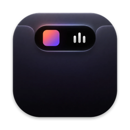
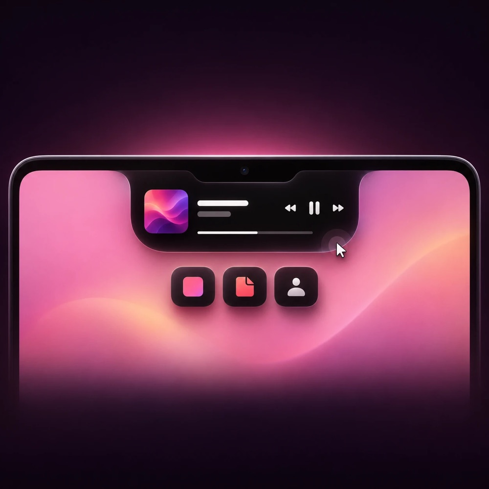
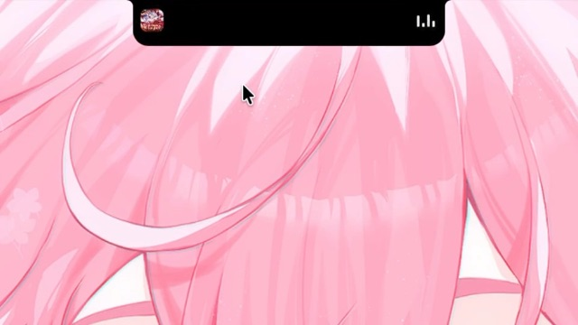
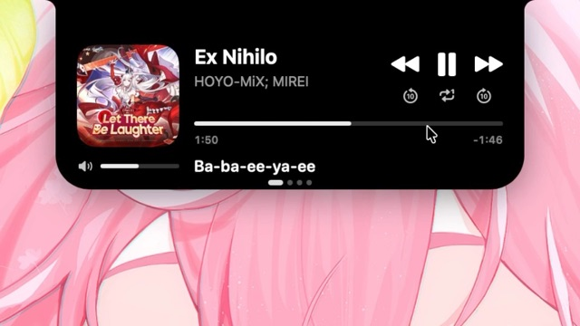
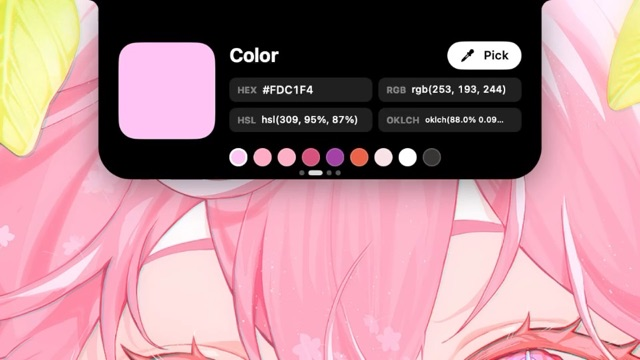
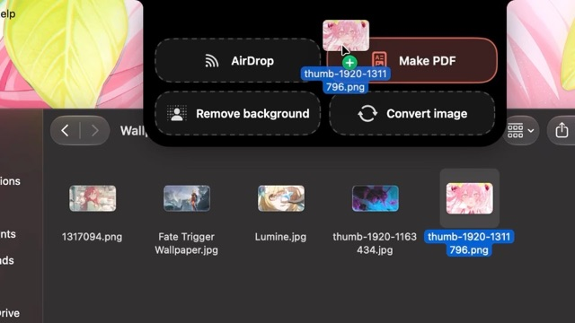
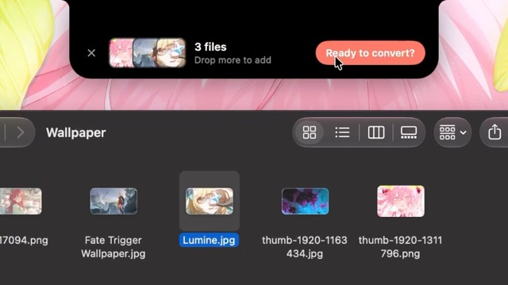
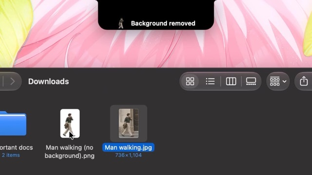

<p align="center">
  
</p>

<h1 align="center">Tuck</h1>

<p align="center"><b>The notch on your Mac that's ready to assist when you need.</b><br>
An app that makes your notch more useful.</p>

<p align="center">
  <a href="https://github.com/sansirk-design/Tuck/releases/latest/download/Tuck.dmg"><b>⬇ Download Tuck</b></a>
  &nbsp;·&nbsp;
  <a href="https://sansirk-design.github.io/#case-tuck">See it in use</a>
</p>

<p align="center">
  <a href="https://sansirk-design.github.io/#case-tuck"></a>
</p>

| | |
|---|---|
| **Version** | 1.0 |
| **Size** | ~1.2 MB |
| **Requirements** | Apple Silicon (M series chips), macOS 14 Sonoma or later |

## Features

| | |
|---|---|
|  | **Peek**<br>Bring the cursor to the notch and the island peeks instantly: album art on one side, a live sound indicator on the other. Move away and it tucks back. Nothing opens until you click. |
|  | **Control your music**<br>Follows whatever is playing on your Mac, the same source Control Center uses. Previous, play and next, with ten seconds back, loop and ten seconds forward beneath. Synced lyrics run line by line and keep up even when you scrub. |
|  | **Color picker**<br>Pick any pixel on screen with a loupe, or press ⌃⌥C from anywhere. The value is copied straight away in HEX, RGB, HSL or OKLCH, and the last 12 colors stay one click away. |
|  | **Drop things into Tuck**<br>Drag any file toward the notch and a 2×2 grid opens: AirDrop, Make PDF, Remove background and Convert image. The target lights up as you hover it, so you always know what will happen before you let go. |
|  | **Need PDF conversion?**<br>Dropped files wait in a small tray that stays open. Keep adding, then press "Ready to convert?" and one PDF lands on your Desktop. |
|  | **Remove the background**<br>Drop a photo and the subject is cut out on your Mac, no upload. The cut-out is saved next to the original, and a small pill confirms it. Images also convert between JPG, PNG, HEIC, AVIF and TIFF. |

### No notch? Tuck still has a home.

On a screen without a notch cutout, like an external monitor or an older Mac, Tuck shows a small punch-hole circle at the top of the screen. It peeks when you get close and opens like a droplet, with every feature intact. That's a feature, not a workaround.

> Tuck can even detect dual displays and adjust depending on whether a notch cutout is present or not.

### Light enough to forget

Hovering only peeks; only a deliberate click, tap or ⌃⌥N opens it. At rest Tuck uses about 14 MB of memory and 0% CPU, with no Dock icon.

## Install

1. Download **Tuck.dmg** and open it.
2. Drag **Tuck** into **Applications**.
3. Open **Tuck** from Applications.

Tuck has no Dock icon: click the notch to open it, scroll inside it to switch features, right-click it for settings.

### Facing difficulty? Don't worry, here's some help.

Tuck is free and isn't signed through a paid Apple developer account, so macOS may block it the first time. These steps are only needed once.

<details>
<summary><b>"Apple could not verify "Tuck" is free of malware…"</b></summary>

1. Click **Done** (not *Move to Trash*).
2. Open **System Settings → Privacy & Security**.
3. Scroll down to **Security**. Next to *"Tuck" was blocked to protect your Mac*, click **Open Anyway**.
4. Enter your Mac password, then click **Open Anyway** again.
</details>

<details>
<summary><b>"Tuck is damaged and can't be opened."</b></summary>

It isn't damaged; this is the same block with scarier wording.

1. Click **Cancel** (not *Move to Trash*).
2. Open **Terminal** (Applications → Utilities → Terminal).
3. Paste this, press **Return**, and Tuck opens:

```sh
xattr -dr com.apple.quarantine /Applications/Tuck.app && open /Applications/Tuck.app
```
</details>

<details>
<summary><b>"Tuck can't be opened because it is from an unidentified developer"</b></summary>

1. Click **OK**.
2. In Applications, **right-click Tuck → Open**, then click **Open**.
3. No Open button? Use the System Settings steps above.
</details>

<details>
<summary><b>"…isn't supported on this type of Mac" or nothing happens</b></summary>

Tuck needs an Apple Silicon Mac (M series chips); it doesn't run on Intel Macs. If it opened but you can't see it, move your mouse to the notch (or the small dot at the top of an external screen) and click.
</details>

## Permissions

On first launch Tuck asks for access to three folders, once, and says why:

- **Downloads:** to show files AirDropped to you.
- **Desktop:** to save the PDFs you make.
- **Documents:** to save converted images and cut-outs next to your files.

The only thing Tuck sends over the internet is the song's title, artist, album and length, to look up synced lyrics on [LRCLIB](https://lrclib.net). You can turn that off in Settings.

## Uninstall

Quit Tuck (right-click the notch → Settings → Quit Tuck), then drag it from Applications to the Trash.

---

Made by Sanjan Sirkar · [Read the full case study](https://sansirk-design.github.io/#case-tuck)
